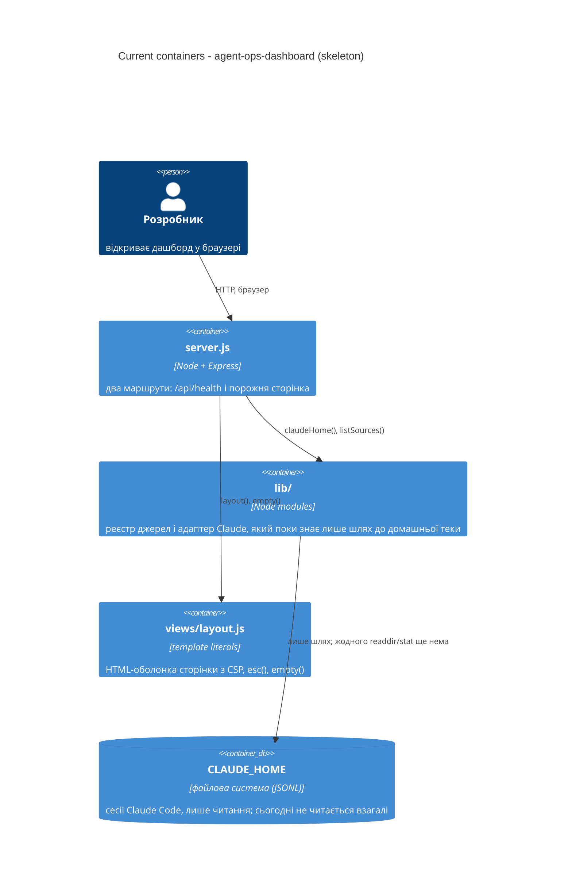

# Architecture map - agent-ops-dashboard

> The **current** architecture (what exists today), produced by `survey` and read by
> specify / design / data-model / implement. Refresh with `survey` when the repo drifts past
> `reflects_commit`. Generated; no hand-maintained `docs/architecture.md` exists in this repo, so
> this map is the reference. `reflects_commit: kit-baseline` = кореневий коміт пакета
> (`git log --oneline | tail -1`).

## Stack

- Language / runtime: Node.js 20+, ES modules (`package.json:5-9`); `.nvmrc` = 22, CI ганяє 22 і 24 на трьох ОС (`.github/workflows/verify.yml:9-12`)
- Frameworks: Express ^5.1.0, єдина залежність (`package.json:18-20`)
- Build / test / lint: `npm run verify` = `node --test test/*.test.js` (два тести на фікстурах) з `preverify`, який вирівнює mtime фікстур (`package.json:11-17`, `scripts/pin-fixture-mtimes.mjs`). Без build step, без лінтера, без TypeScript. `npm run demo` = сервер на фікстурах через `--env-file=.env.fixtures`.

## C4 - system as it is

## Module inventory

| Module | Path | Layers | Wired at | Responsibility |
|---|---|---|---|---|
| server | `server.js` | app/wiring | `server.js:4-6` | маршрути Express, підключає lib до views; імпортує `lib/claude` напряму, поруч із реєстром |
| sources | `lib/sources.js` | infra/registry | `lib/sources.js:12-18` | реєстр адаптерів джерел (`registerSource`, `getSource`, `listSources`) |
| claude adapter | `lib/claude/` | infra | `lib/claude/index.js:14-18` | `claudeHome()`, `projectsDir()`, самореєстрація в реєстрі; функцій читання диска ще нема |
| views | `views/layout.js` | presentation | `views/layout.js:11-33` | єдина HTML-оболонка: CSP, `<header>`, `<main>`; `esc()` і `empty()` |
| public | `public/style.css` | presentation (клієнт) | `views/layout.js:19` | стилі; клієнтського JS нема |
| test | `test/` | tests | `test/helpers.js:10-23` | `startServer()` на вільному порту, `CLAUDE_HOME` на фікстури, оракули з диска в `test/oracle.js` |
| scripts | `scripts/` | tooling | `package.json:12,15` | генерація фікстур і pin mtime |

## Conventions (cited)

- **Module wiring / registration:** адаптери джерел реєструються через `registerSource({id, label, home})` у `Map()` (`lib/sources.js:12-18`); адаптер Claude робить це сам при імпорті (`lib/claude/index.js:14-18`). Реєстр сьогодні годує лише `/api/health` (`server.js:14`); `server.js` імпортує `claudeHome` з `lib/claude/index.js` напряму (`server.js:4`), тобто сторінка про реєстр не знає.
- **Error handling:** у скелеті помилок ще нема, бо диск не читається; `registerSource` кидає `Error` на адаптер без `id`/`label`/`home` (`lib/sources.js:13-15`). Конвенція для нових функцій читання: нечитабельний файл або тека → порожній результат, не крах (задано в `docs/idea-brief.md` §Межі).
- **IDs:** у скелеті не визначені. У фікстурах `sessionId` = імʼя файлу без `.jsonl`, slug проєкту = імʼя теки з `/` → `-` (`scripts/make-fixtures.mjs:62-66`, `fixtures/claude-home/projects/`).
- **Persistence / DB access:** БД немає; файлова система `CLAUDE_HOME` (типово `~/.claude`), суворо read-only (`lib/claude/index.js:6-12`). Розкладка: `projects/<slug>/<sessionId>.jsonl`, поруч під `<sessionId>/` лежать `subagents/*.jsonl` і `tool-results/*.txt`, які сесіями не є (`fixtures/claude-home/projects/-Users-demo-sources-checkout-api/`).
- **Migrations:** відсутні. N/A
- **Tests:** `node --test`, кожен suite стартує застосунок через `startServer()` (`test/helpers.js:10-23`) на `CLAUDE_HOME=fixtures/claude-home` (`test/helpers.js:5-8`); підрахунки з диска через `test/oracle.js` (`sessionFiles` з `exactDepth`, `countAcross`, `jsonlRecords`), без shell-команд (`test/oracle.js:1-9`). mtime фікстур вирівнюється перед кожним прогоном (`scripts/pin-fixture-mtimes.mjs`, `package.json:15`).
- **Inter-module communication:** прямі виклики функцій server → lib → views (`server.js:13-24`). Без подій, без SSE.
- **UI / styling:** без фреймворку. HTML з template literals, CSP `default-src 'none'; style-src 'self'; script-src 'self'` (`views/layout.js:17`), CSS custom properties, моноширинний шрифт (`public/style.css:1-18`).
- **Line endings / env:** `* text=auto eol=lf` (`.gitattributes:1`); `.env.fixtures` задає `CLAUDE_HOME` і `PORT` для `demo` (`.env.fixtures:1-2`).

## Datastores

| Store | Engine | Accessed via | Notes |
|---|---|---|---|
| CLAUDE_HOME | файлова система, JSONL-файли | `lib/claude/index.js` (поки лише шлях) | лише читання; `projects/<slug>/<sessionId>.jsonl`; вкладені `subagents/` і `tool-results/` це не сесії; у фікстурах шість сесій у трьох проєктах, mtime кожного файлу = його останній `timestamp` |

## Frontend / UI foundation

- **Component library / design system:** немає стороннього кіта; спільна оболонка `layout()` (`views/layout.js:11-33`)
- **Design tokens:** CSS custom properties `--bg`, `--panel`, `--line`, `--text`, `--muted`, `--accent`, `--bad`, `--good`, `--warm` (`public/style.css:1-11`)
- **Styling approach:** vanilla CSS, один файл, без препроцесора (`public/style.css`)
- **Shared primitives:** `esc()` для HTML-escaping (`views/layout.js:3-9`), `empty()` для порожнього стану (`views/layout.js:35-37`); готові стилі таблиці, `.num` для чисел, `.dim`, `.sub` (`public/style.css:32-39`)
- **State / data-fetching:** клієнтського JS немає; сторінка рендериться на сервері цілком (`views/layout.js:17` CSP дозволяє лише `self`)
- **Closest UI precedent:** порожня сторінка `/` = `layout({ title, body })` з `empty(...)` (`server.js:17-24`); таблиця стилізована наперед у `public/style.css:32-37`

## Where things live / closest precedents

- Нова функція читання диска для Claude → `lib/claude/index.js` поруч із `claudeHome()`/`projectsDir()` (`lib/claude/index.js:6-12`); викликається з `server.js` або через реєстр (`getSource('claude')`, `lib/sources.js:20-24`).
- Новий JSON-маршрут → `app.get('/api/...')` за зразком `/api/health` (`server.js:13-15`).
- Нова сторінка → чиста функція `views/<name>.js`, яка повертає рядок для `layout({ body })`, за зразком `server.js:17-24`; таблиця на класах із `public/style.css:32-37`.
- Новий тест → `test/<slice>.test.js` за зразком `test/skeleton.test.js:1-19`, дані з диска через `test/oracle.js`.
- Новий адаптер джерела (другий агент) → `lib/<agent>/index.js` з `registerSource(...)` за зразком `lib/claude/index.js:14-18`; але `server.js:4` імпортує Claude напряму, тож без зміни wiring другий адаптер до сторінки не дійде.

## Constraints & known tech-debt

- **Реєстр джерел підключений лише до `/api/health`** (`server.js:4-5,14`). Сторінка бере `claudeHome()` прямим імпортом. Перша фіча, що показує дані, вирішує: читати через реєстр чи напряму; це рішення варто зафіксувати, бо на ньому тримається обіцянка «другий адаптер без змін `server.js`».
- **Диск ще не читається.** У `lib/claude/` немає жодного `readdir`/`stat`; межа «лише налаштована тека, нічого поза нею» існує лише як намір у `docs/idea-brief.md` §Межі.
- **mtime фікстур живе поза git.** Після clone усі файли сесій мають одну дату; `preverify`/`predemo` вирівнюють їх (`scripts/pin-fixture-mtimes.mjs`). Будь-який тест на порядок «від свіжих» коректний лише після цього кроку.
- **Тести без shell.** CI ганяє Windows (`.github/workflows/verify.yml:10`); `find`/`grep`/`wc`/`jq` у тестах там відсутні. Оракули в `test/oracle.js`.
- **Немає `model_context_window` у транскриптах**; жодна майбутня аналітика не може показати % використання контексту.
- **Порожній стан на `/`** (`server.js:22`) це поточна поведінка, яку перша фіча замінює; `/api/health` і CSP-оболонка мають лишитися як є (`test/skeleton.test.js:8-19`).

## Reconciliation with the authored architecture doc

Немає авторського `docs/architecture.md`; кореневий `CLAUDE.md` задає правила для агента (дані лише з фікстур, тести без shell, `examples/` не читати) і з цією картою не розходиться.
