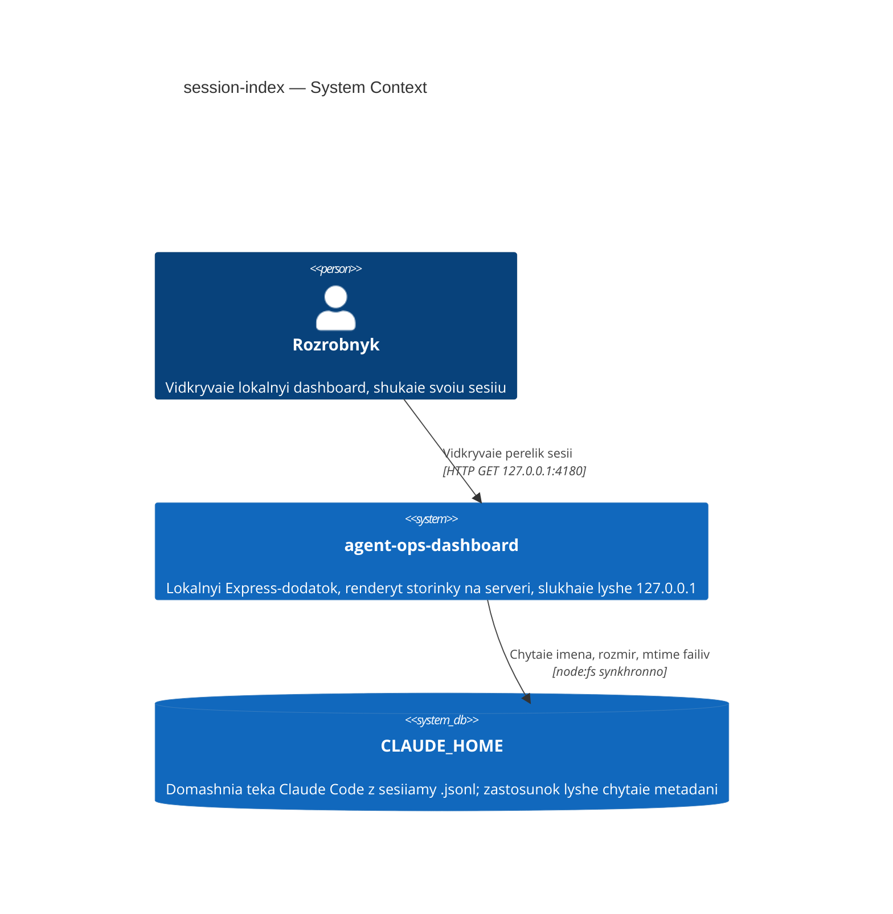
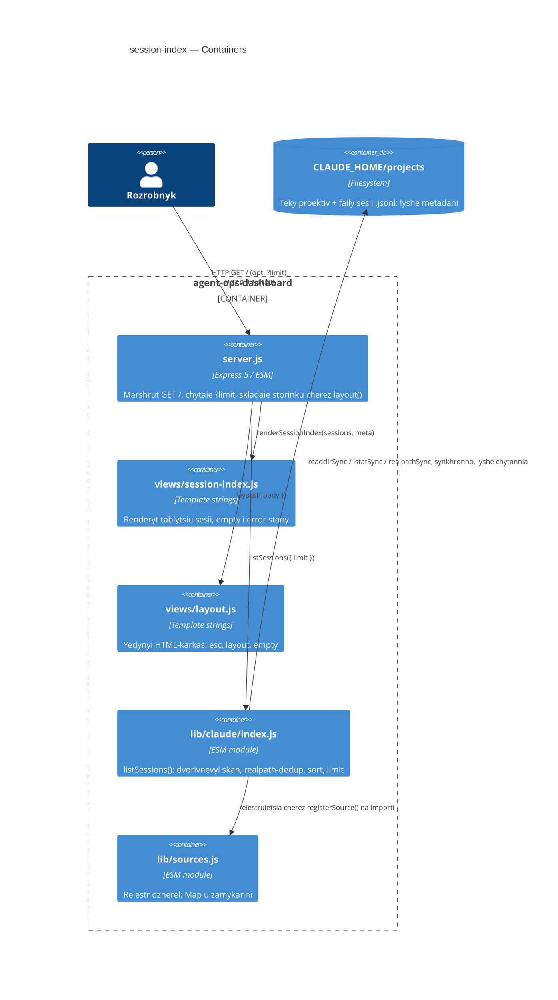
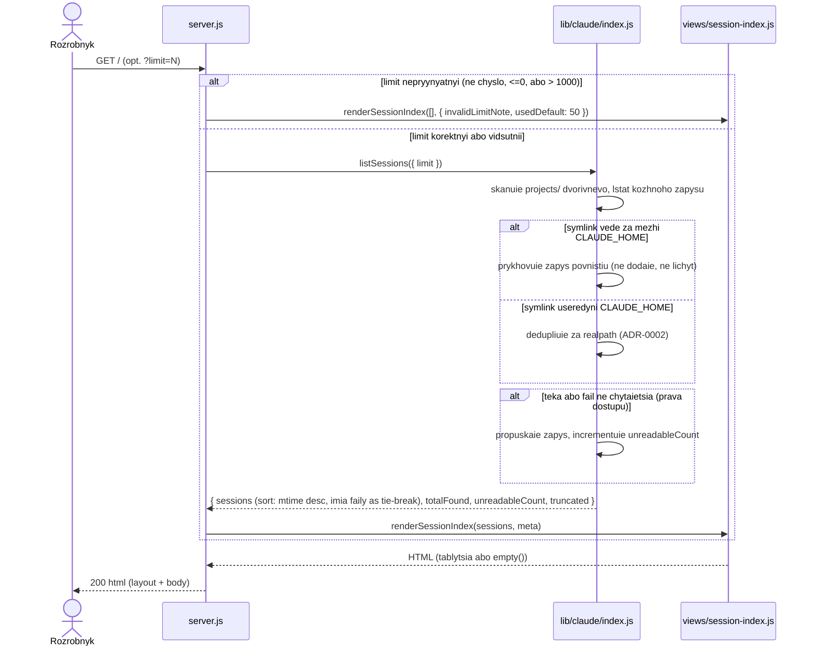

# Software Architecture Document — session-index

## 1. Introduction and goals

**Intent.** Розробник тримає домашню теку coding-агента з сесіями, розкиданими по закодованих текам проєктів, і сьогодні знаходить потрібну лише руками у файловому менеджері. `session-index` додає на головну сторінку дашборда перелік усіх сесій усіх проєктів, зібраний виключно з метаданих файлів (імʼя, розмір, час зміни), відсортований від найсвіжіших до найстаріших і обрізаний лімітом. Це перший крок роадмапи — кроки 2 (перегляд сесії) і 3 (вартість у токенах) починаються з вибору рядка в цьому переліку.

**Top-3 quality goals (1-liners; full scenarios in §10):**

1. Безпека читання джерела — нуль записів у домашню теку, нічого поза її межами, жодного рядка тексту розмови на сторінці. Критично, бо це перша фіча, яка взагалі обходить диск джерела.
2. Продуктивність на реальному масштабі — перелік лишається швидким не лише на 6-сесійних фікстурах, а й на домашній теці з сотнями чи тисячами сесій.
3. Стійкість до часткової нечитабельності джерела — одна нечитабельна тека чи файл не гасить сторінку, і розробник бачить, що частина не прочиталася, а не вважає неповний перелік повним.

**Stakeholders.**

| Role | Interest | Sign-off owner? |
|---|---|---|
| розробник | бачить перелік своїх сесій усіх проєктів з однієї сторінки | No |
| джерело (Claude Code, `lib/claude/index.js`) | контракт адаптера `listSessions()` нарешті виконаний | No |
| Tech Lead (maintainer) | SAD approval | Yes |

<!-- Decision overrides (¶4) — none yet. -->

## 2. Constraints

**Technical.**
- JavaScript, ESM (`"type": "module"`), Node `>=22` (`package.json`, `.nvmrc`).
- Express `^5.1.0` — єдина залежність, нових не додаємо.
- Синхронний `node:fs` (`readdirSync`, `lstatSync`, `readFileSync`) — `node:fs/promises` у репо немає.
- Без класів: стан живе в замиканні або в plain-обʼєкті; лише named exports.

**Organisational.**
- Розмір S, route `standard` (`.size`, `.route`), effort ≈ 2–5 PR, ~1 тиждень.
- Один розробник (maintainer) веде фічу соло, без окремої команди.

**Conventions.**
- `AGENTS.md` §Межі і §Конвенції; `docs/architecture-map.md` §Conventions.
- Помилки: `throw new Error('текст')` без кодів і власних класів; `catch` без привʼязки до змінної, дефолт замість прокидання (`lib/sources.js:14`, `test/oracle.js:17`).
- Нове читання з диска йде функцією в адаптері (`lib/claude/index.js`); нова сторінка складнішого вигляду виносить рендер в окремий файл `views/<page>.js` (`views/AGENTS.md`).

**Regulatory / external.**
- spec §6.1: класифікація даних — confidential (метадані самі по собі кажуть, над чим і коли працював розробник). Нових персональних полів не створюємо.
- Security review: Required — фіча вперше дає застосунку обходити диск; перевірка запланована окремим проходом на етапі приймання (spec §6.1).

## 3. Context and scope

Локальний дашборд `agent-ops-dashboard` читає домашню теку coding-агента Claude Code (`CLAUDE_HOME`, дефолт `~/.claude`) і показує розробнику, що на диску є, не виходячи за межі цієї теки. `session-index` додає на головну сторінку перелік усіх сесій усіх проєктів; за межами фічі лишається сам вміст сесії (крок 2) і вартість у токенах (крок 3).

<!-- brownfield: docs/architecture-map.md fresh (reflects_commit 7ebfee8, HEAD 84e70aa — один docs-коміт попереду, код не змінювався); прочитано замість повторного сканування. -->

**External systems (in / out):**

| Actor or system | Type | Interaction |
|---|---|---|
| розробник | Person | HTTP GET на `127.0.0.1:4180`, дивиться на перелік сесій |
| `CLAUDE_HOME/projects` (файлова система Claude Code) | System (external, вже інтегроване через `lib/claude/index.js`) | синхронне читання метаданих файлів; лише читання, обхід рівно дворівневий |

**C4 Context (L1):**



Дашборд показує розробнику його власний перелік сесій; жодної третьої сторони, зовнішнього API чи ідентифікаційного провайдера немає — застосунок локальний, петльовий, без облікових записів.

## 4. Solution strategy

**Target surface: `web-frontend`.** Фіча лише додає сторінку в наявний server-rendered Express-застосунок; non-goals (spec §3) прямо виключають другий адаптер джерела і нову JSON-поверхню. Альтернативи в межах цієї фічі немає — рішення прийняте як easy-режимне припущення, без ADR (0 з 3 критеріїв блast-radius: немає реальної альтернативи в межах спека).

**UI-архітектура (для поверхні `web-frontend`): server-rendered, без клієнтського JS.** CSP у `layout()` вже забороняє inline- і зовнішні скрипти (`views/layout.js:17`), а конвенція репо прямо каже «UI-фреймворк і збірку фронтенду не додаємо» (`.claude/rules/views.md`). Альтернатива (SPA) виключена наявним обмеженням — без ADR (критерій «має легітимну альтернативу» не спрацьовує).

**Top strategic choices (ADR seeds):**

1. **Синхронний скан без кешу, перебудова індексу на кожен запит** — жодного персистентного чи кешованого стану між запитами; адаптер щоразу обходить `CLAUDE_HOME/projects` рівно два рівні, сортує в памʼяті (mtime спадаюче, імʼя файлу як другий ключ) і обрізає лімітом після сортування. Торкається продуктивності (quality goal 2) і межі «Записи в домашню теку джерела — 0» (spec §6 NFR). → **ADR-0001**.
2. **Дедуп символічних посилань за realpath, відхилення зовнішніх** — межа довіри для обходу теки проєктів: посилання за межі `CLAUDE_HOME` приховується повністю (AC-09), посилання всередину дедуплікується за реальним шляхом (AC-09b). Торкається безпеки читання (quality goal 1) і §6.1 Abuse cases. → **ADR-0002**.

**Тактичні рішення (easy-режим, без ADR — низький blast radius):**

- **Механізм «іншої довжини переліку» (AC-05, spec §8 OQ)** — query-параметр `?limit=N` на `GET /`; неприпустиме значення (не число, ≤0, >1000) не ламає сторінку, а показує типовий ліміт 50 і пояснення простими словами.
- **Формат розміру файлу (spec §8 OQ, дефолт уже узгоджений)** — людський вигляд (КБ/МБ) у клітинці таблиці, точне значення байтів в атрибуті `title`.
- **Формат часу зміни (spec §8 OQ, дефолт уже узгоджений)** — абсолютний локальний час: стабільний у тестах, не залежить від моменту відкриття сторінки.

Кожне з двох стратегічних рішень трасується у §5 (модульні межі), §6 (потік виконання) і §10 (сценарії якості) нижче.

## 5. Building block view

Наявний простий шар: адаптер джерела (`lib/claude/index.js`) володіє читанням з диска, `server.js` лишається тонким маршрутом, `views/` — HTML-шар без знання про джерела. Нового модуля не заводимо (easy-режимне припущення) — S-розмір фічі вкладається в наявну форму: логіка скану йде в адаптер (конвенція «нове читання з диска → функція в адаптері»), рендер таблиці виносимо в окремий `views/session-index.js`, бо `views/AGENTS.md` прямо каже: «складніша сторінка виносить свою функцію в окремий файл».

**Internal decomposition:**

```
lib/claude/index.js       # + listSessions({ limit }) — synchronous two-level scan (ADR-0001),
                           #   realpath dedup + reject external symlinks (ADR-0002), sort, limit
server.js                 # GET / reads ?limit, calls listSessions(), passes result to the view
views/session-index.js    # NEW: pure render function — table markup + empty()/error notes, esc() everything
views/layout.js           # unchanged — esc, layout, empty stay generic chrome
```

**C4 Container (L2):**



Обидва стратегічні рішення §4 живуть у `lib/claude/index.js:listSessions()` — ADR-0001 фіксує відсутність кешу, ADR-0002 фіксує дедуп за realpath. `server.js` і `views/session-index.js` про ці рішення не знають, вони лише споживають готовий результат.

## 6. Runtime view

**Critical flow 1: відкриття переліку сесій (happy path + edge branches inline)**

S-розмір фічі: один потік із `alt`-гілками покриває всі §5 AC замість окремих потоків на кожен edge case (детальне покриття кожного AC — робота стадії `sequences`).



**Critical flow 2: порожня домашня тека / тека проєктів ще не існує (AC-06, AC-07)** — N/A як окремий потік: покривається тією самою гілкою «limit коректний» вище — `listSessions()` повертає порожній масив `sessions`, `View` рендерить `empty()` замість таблиці; `AC-06` додатково показує повний шлях `CLAUDE_HOME`, який читала сторінка (тека не створюється).

Обидва участники (`Adapter`, `View`) — контейнери з §5; повідомлення семантичні, без HTTP-деталей (ендпоінт-рівень фіксує стадія `api`, якщо вона знадобиться — для цієї фічі немає нового JSON-контракту).

## 7. Deployment view

<!-- N/A: reuses existing deployment unit — той самий локальний Express-процес на 127.0.0.1:4180, ні нового процесу, ні нової інфраструктури фіча не додає (easy-режимне припущення). -->

## 8. Crosscutting concepts

| Concept | Convention | Where defined |
|---|---|---|
| Logging | немає структурованого логування; єдиний `console.log` при старті сервера | `server.js` |
| Authentication | немає — локальний петльовий інтерфейс, без облікових записів | `server.js` (bind `127.0.0.1`), `AGENTS.md` §Межі |
| Error handling | `throw new Error('текст')` без кодів і власних класів; читання джерела — best-effort skip + лічильник замість прокидання | `lib/sources.js:14`, `test/oracle.js:17` |
| ID strategy | `sessionId` — UUID у назві файлу `<sessionId>.jsonl`, готовий з диска, не генерується застосунком | `CONTEXT.md` §Glossary |
| Internationalisation | N/A — єдина мова інтерфейсу, `lang="uk"` | `views/layout.js` |
| Observability | N/A — локальний однокористувацький процес без SLO/пропускної здатності (spec §6 NFR) | spec §6 NFR |
| Events | N/A — синхронний HTTP request/response, подій немає | — |

## 9. Architecture decisions

| # | Title | Status | Section |
|---|---|---|---|
| 0001 | Rebuild the session index synchronously per request, with no cache or persisted store | Accepted | §4 |
| 0002 | Deduplicate the project scan by realpath and reject symlinks that resolve outside CLAUDE_HOME | Accepted | §4 |

ADR files live under `docs/features/session-index/adr/NNNN-<title>.md`.
