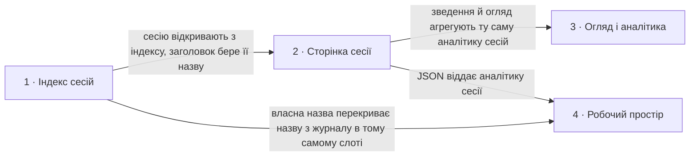

# Roadmap — agent-ops-dashboard

> **Це декомпозиція, а не обіцянка.** Ідея розбита на кілька великих кроків: що робимо, звідки
> взялася потреба і наскільки крок великий, або що на нього ще ніхто не дивився (`fog`). Дат
> немає, крім історії внизу; балів теж немає, бо пріоритет задає порядок. Кроків навмисно мало
> і вони обʼємні: кожен має давати значущу річ і повний прохід SDD. Саме рішення для кроку живе
> в його теці `docs/features/<slug>/`. Джерело ідеї: [`idea-brief.md`](idea-brief.md); вигляд
> задає [`design-system.md`](design-system.md).

## Destination

Розробник відкриває локальний дашборд і за хвилину розуміє, що робив coding-агент у його проєктах: знаходить сесію за назвою чи проєктом, бачить її хронологію, моделі, інструменти й оцінку вартості, а на огляді за тиждень бачить, куди пішли час і гроші, і все це без жодного запису в домашню теку агента.

## Steps

| # | Step | Source | Size | Status |
|---|---|---|:---:|---|
| 1 | [`session-index`](features/session-index/): головна сторінка як дашборд сесій, а не перелік: сесії згруповані за проєктом із людською назвою проєкту з робочої теки, кожна сесія з назвою з журналу (fallback на id), людською датою й розміром; рядок зведення, перемикач довжини переліку, пошук за назвою чи id і фільтр за проєктом, стан у параметрах запиту; закритий перелік полів журналу, які дозволено читати, записаний у межах проєкту | `README.md` §«Яку зміну починаємо», `idea-brief.md` §1. Raw idea, §7. Recommendation | M | spec'd |
| 2 | `session-page`: сторінка однієї сесії: назва, проєкт, хронологія подій без тексту (запити, відповіді, виклики інструментів з назвою і статусом, компакти, субагенти), тривалість і паузи, аналітика всередині сесії: моделі, токени за типами, оцінка вартості за таблицею цін із датою, топ інструментів і частка їхніх помилок; команда для продовження сесії | `idea-brief.md` §2. Problem, §7. Recommendation, §5. Out of scope | L | idea |
| 3 | `overview`: аналітика по всіх сесіях: зведення на головній (сесій і проєктів за 7 і 30 днів, оцінка витрат, графік активності за днями) і окрема сторінка огляду за тиждень і місяць: тренди активності й витрат, порівняння проєктів, частка моделей, найчастіші інструменти та їхні помилки, найдорожчі й найдовші сесії з переходом на них; сортування переліку за вартістю | `idea-brief.md` §7. Recommendation, §6. Risks, §1. Raw idea | L | idea |
| 4 | `workspace`: дашборд як робочий інструмент, а не лише перегляд: власна назва й теги сесії, які розробник задає з дашборду і які зберігаються у сховищі дашборду поза домашньою текою агента, з пріоритетом над назвою з журналу; пошук і фільтр за тегами; JSON-доступ до індексу, сесії та її аналітики на тій самій локальній адресі для інших інструментів | `idea-brief.md` §1. Raw idea, §3. Users, §8. Open questions | M | idea |

## Not yet specified

| Area | What we'd have to learn | Blocks | How it gets sharpened |
|---|---|:---:|---|
| Друге джерело за контрактом `registerSource` | Де інший coding-агент тримає журнали сесій, чи є там аналоги проєкту, назви, моделей і використання токенів, і чи лягає це на контракт адаптера без зміни сторінок. Кроком стане після розвідки, зараз не нумеруємо | — | Розвідка формату чужої домашньої теки на синтетичних фікстурах, потім новий рядок у Steps і `specify` |

## Out of scope

- Показ тексту розмови в будь-якому вигляді, включно з превʼю й tooltip. Дашборд показує події й числа, а не зміст; це межа приватності з [`idea-brief.md`](idea-brief.md) §5.
- Запис у `CLAUDE_HOME`. Межа стоїть у розділі «Межі» в [`AGENTS.md`](../AGENTS.md): джерело сесій лише читаємо; власні назви живуть у сховищі дашборду.
- Кілька користувачів, облікові записи й доступ по мережі. Дашборд працює на машині розробника і слухає лише `127.0.0.1`.
- Клієнтський фреймворк, збірка фронтенду, зовнішні шрифти й ресурси, нові залежності. Закріплено CSP і [`design-system.md`](design-system.md).
- Точна фінансова звітність. Вартість це оцінка за таблицею цін, позначена як оцінка.
- Редагування чи видалення сесій із дашборду.

## Open decisions

| # | Question | Type | Owner | Blocks |
|---|---|:---:|:---:|:---:|
| D3 | Який закритий перелік типів записів і полів журналу дозволено читати для назв, хронології й використання токенів, і як саме доповнити розділ «Межі» в `AGENTS.md` разом зі специфікацією кроку 1 | task | human | 1, 2, 3 |
| D4 | Звідки береться таблиця цін за токен, у якому файлі живе, як оновлюється без нової залежності і що показувати для невідомої моделі | research | agent | 2 |
| D5 | Де живе сховище дашборду для власних назв і тегів (шлях, формат, змінна середовища) і як це записати в «Межі» | grilling | human | 4 |
| D6 | Чи вкладається читання всіх сесій для зведення за 30 днів у прийнятний час без кешу на реальній домашній теці, і де жив би кеш, якби був потрібен | prototype | agent | 3 |

## Decisions so far

- Сесія це один файл на одному рівні; вкладені транскрипти сесіями не є → [`CONTEXT.md`](../CONTEXT.md)
- Проєкт показуємо як відновлений шлях із позначкою «похідний», доки крок 1 не дасть назву з робочої теки → [`CONTEXT.md`](../CONTEXT.md)
- Індекс будуємо з метаданих файлів; читання вмісту журналу дозволяється лише для службових полів і лише там, де специфікація прямо цього вимагає → [`AGENTS.md`](../AGENTS.md) §Межі, [`idea-brief.md`](idea-brief.md) §7
- D1: перелік сортуємо за часом зміни, потім обрізаємо; типова довжина 50, стеля 1000, неприпустиме значення пояснюємо → [`spec.md`](features/session-index/spec.md) §5 AC-04, AC-05
- D2: немає теки проєктів або вона порожня → порожній стан; нечитабельний проєкт пропускаємо і показуємо кількість → [`spec.md`](features/session-index/spec.md) §5 AC-06…AC-08
- Дизайн-канон живе в коді, позиція responsive-both, токени в `public/style.css` → [`design-system.md`](design-system.md)
- Стан інтерфейсу (ліміт, фільтри, згортання груп) живе в параметрах запиту як посилання, без клієнтського JS, поки фіча прямо його не вимагає → [`design-system.md`](design-system.md) §Interaction & writing conventions
- Вартість завжди позначена як оцінка з датою таблиці цін → [`idea-brief.md`](idea-brief.md) §5, §6
- Роадмап тримаємо коротким, три-чотири обʼємні кроки, щоб кожен давав повний прохід SDD → [`idea-brief.md`](idea-brief.md) §3, §6

## Dependency graph

## Execution path

| Wave | Steps | Zone per step (why parallel-safe) | Unlocks |
|:---:|---|---|---|
| 1 | 1 | `lib/claude/` · `server.js` · `views/session-index.js` · `AGENTS.md` §Межі | 2, 4 |
| 2 | 2 | `lib/claude/` (хронологія, використання токенів) · `lib/pricing.js` (new) · `views/session.js` (new) · новий маршрут у `server.js` | 3, 4 |
| 3 | 3 ∥ 4 | 3: `lib/claude/` (агрегати за період) · `views/overview.js` (new) · зведення у `views/session-index.js`; 4: `lib/store/` (new) · `views/labels.js` (new) · `lib/api/` (new) · маршрути `/api/*`. Спільний файл лише `server.js`, різні маршрути; крок 4 читає назви через `lib/store/`, не торкаючись агрегатів кроку 3 | — |

Друге джерело у хвилі не входить: спершу розвідка з «Not yet specified».

## Shipped

| Step | Shipped | Link |
|---|---|---|
