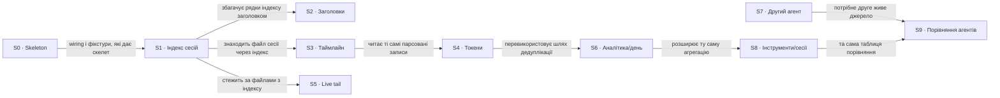

# Roadmap - agent-ops-dashboard

> **Декомпозиція без обіцянок.** Загальна ідея, розкладена на інкрементальні кроки: що це за крок,
> звідки він, який він завбільшки (або що на нього ще ніхто не дивився), і в якому порядку та
> якими паралельними доріжками їх проходимо. **Без дат** (крім історії Shipped), **без оцінок**:
> порядок і є пріоритезацією. Рішення для кожного кроку живе в його `docs/features/<slug>/spec.md`.

## Destination

Розробник відкриває локальний дашборд і бачить усі свої агентні сесії з диска: скільки їх, у яких проєктах, що в них відбувалося, скільки коштували і що діється просто зараз, без жодного запису назад у домашню теку.

## Steps

| # | Step | Source | Size | Status |
|---|---|---|:---:|---|
| S0 | Skeleton: сервер, layout, CSS, фікстури, verify harness | idea-brief.md §"Що вже є" | S | shipped |
| S1 | Індекс сесій: перелік файлів сесій із проєктом, розміром і часом, від свіжих, лише з fstat | idea-brief.md §"Наступний крок беклогу" | S | idea |
| S2 | Людські заголовки сесій з `ai-title` у файлі | idea-brief.md §"Далі за індексом" | XS | idea |
| S3 | Таймлайн подій однієї сесії (повний parse на запит) | idea-brief.md §"Далі за індексом" | S | idea |
| S4 | Облік токенів із дедуплікацією по `message.id` | idea-brief.md §"Далі за індексом" | M | idea |
| S5 | Live tail через SSE | idea-brief.md §"Далі за індексом" | M | idea |
| S6 | Аналітика по днях із чесним `scanned`/`skipped` | idea-brief.md §"Далі за індексом" | M | idea |
| S7 | Другий агент-джерело за контрактом `registerSource` → see [Not yet specified](#not-yet-specified) | idea-brief.md §"Далі за індексом" | fog | idea |
| S8 | Розбивка аналітики по інструментах і сесіях | idea-brief.md §"Далі за індексом" | M | idea |
| S9 | Порівняння агентів між джерелами | idea-brief.md §"Далі за індексом" | M | idea |

## Not yet specified

| Area | What we'd have to learn | Blocks | How it gets sharpened |
|---|---|:---:|---|
| Другий агент-джерело (S7) | формат його логів, де лежить домашня тека, як поля лягають на спільну схему записів (`type`, `message.id`, `timestamp`); і чи правда, що сторінка дійде до другого адаптера без змін `server.js`, коли `server.js:4` імпортує Claude напряму | S7, S9 | розвідка на реальних логах одного конкретного агента, потім `/sdd:interview` на звужену ідею |

## Out of scope

- Запис у `CLAUDE_HOME` у будь-якій формі: дашборд лише читає, це межа з idea-brief.
- Відсоток використання контекстного вікна: у транскриптах немає `model_context_window`, вигадувати число не будемо.
- Wall time сесії: транскрипт дає лише перший і останній `timestamp`; показуємо «observed span» і називаємо його так.

## Open decisions

| # | Question | Type | Owner | Blocks |
|---|---|:---:|:---:|:---:|
| D1 | Що вважати сесією: лише `<sessionId>.jsonl` рівно на один рівень під текою проєкту, чи будь-який `.jsonl` рекурсивно (тоді транскрипти з `subagents/` стануть сесіями)? Зараз: один рівень | grilling | human | S1 |
| D2 | Як показувати проєкт: сирий slug теки (`-Users-demo-sources-checkout-api`) чи відновлений шлях з позначкою, що він похідний? Зараз: похідний шлях із позначкою | grilling | human | S1 |
| D3 | Чи потрібен ліміт на кількість сесій у переліку на першому зрізі, і що він робить із порядком? Зараз: параметр з розумним дефолтом, без пагінації | grilling | human | S1 |

## Decisions so far

- Індекс живе на метаданих файлової системи (fstat), вміст файлів на першому зрізі не читається → [`docs/idea-brief.md`](idea-brief.md) §"Наступний крок беклогу"
- Порожня або відсутня тека проєктів дає порожній стан замість помилки → [`docs/idea-brief.md`](idea-brief.md) §"Наступний крок беклогу"
- Адаптери джерел реєструються через `registerSource({id, label, home})`; сьогодні реєстр годує лише `/api/health` → [`docs/architecture-map.md`](architecture-map.md) §Constraints

## Dependency graph

## Execution path

| Wave | Steps | Zone per step (why parallel-safe) | Unlocks |
|:---:|---|---|---|
| 1 | S1 | `lib/claude/index.js` + `server.js` + `views/sessions.js` (new) | S2, S3, S5 |
| 2 | S2 ∥ S5 | S2: `lib/claude/` (читання заголовка) + `views/sessions.js` (new у S1) · S5: `lib/watch.js` (new) + `public/live.js` (new) + SSE-маршрут у `server.js`; спільних файлів нема, `server.js` чіпає лише S5 | S3 (після S2, бо ділять `lib/claude/`) |
| 3 | S3 | `lib/claude/parse.js` (new) + `views/session.js` (new) + маршрут у `server.js` | S4 |
| 4 | S4 | `lib/claude/tokens.js` (new) + `views/session.js` (new у S3) | S6 |
| 5 | S6 | `lib/stats.js` (new) + `views/analytics.js` (new) + маршрут у `server.js` | S8 |
| 6 | S8 | `lib/stats.js` (new у S6) + `views/analytics.js` (new у S6): та сама зона, що S6, тому після нього | S9 |
| recon | S7 | розвідка поза кодом; після неї S7 отримує розмір і власну хвилю | S9 |

## Shipped

| Step | Shipped | Link |
|---|---|---|
| S0 | 2026-09-06 | кореневий коміт пакета `kit baseline` |
