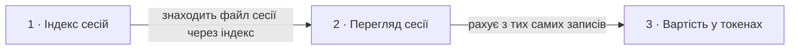

# Roadmap: agent-ops-dashboard

> Це декомпозиція. Кожен рядок каже, що робимо, звідки взялася потреба і наскільки
> крок великий. Розмір `fog` означає, що на крок ще ніхто не дивився уважно.
> Дат тут немає, крім історії внизу; балів теж немає, бо пріоритет задає порядок.
> Саме рішення для кроку живе в його теці `docs/features/<slug>/`.

## Destination

Розробник відкриває локальний дашборд і бачить свої сесії coding-агентів з диска: які є, у яких проєктах, що в них відбувалося і скільки вони коштували, без жодного запису в домашню теку агента.

## Steps

| # | Step | Source | Size | Status |
|---|---|---|:---:|---|
| 1 | Індекс сесій: перелік сесій усіх проєктів із проєктом, розміром і часом зміни, від свіжих | `README.md` §«Яку зміну починаємо» | S | idea |
| 2 | Перегляд однієї сесії → див. [Not yet specified](#not-yet-specified) | `docs/roadmap.md` §Destination | fog | idea |
| 3 | Вартість сесії в токенах → див. [Not yet specified](#not-yet-specified) | `docs/roadmap.md` §Destination | fog | idea |
| 4 | Друге джерело за контрактом registerSource → див. [Not yet specified](#not-yet-specified) | `docs/roadmap.md` §Destination | fog | idea |

## Not yet specified

| Area | What we'd have to learn | Blocks | How it gets sharpened |
|---|---|:---:|---|
| Перегляд сесії | Які записи JSONL показувати і як не витягти на сторінку приватний текст, якого розробник не просив | 2, 3 | Розвідка формату на фікстурах, потім `specify` |
| Друге джерело | Де інший агент тримає логи і чи лягають вони на контракт адаптера | 4 | Розвідка формату чужої домашньої теки |

## Out of scope

- Запис у `CLAUDE_HOME`. Межа стоїть у `docs/rules/session-data.md`: джерело сесій лише читаємо.
- Кілька користувачів, облікові записи й доступ по мережі. Дашборд працює на машині розробника і слухає лише `127.0.0.1`.

## Open decisions

| # | Question | Type | Owner | Blocks |
|---|---|:---:|:---:|:---:|
| D1 | Скільки сесій показуємо в переліку і що цей ліміт робить із порядком, коли їх більше | grilling | human | 1 |
| D2 | Що бачить розробник, коли теки проєктів немає або вона порожня | grilling | human | 1 |

## Decisions so far

- Сесія це один файл на одному рівні; вкладені транскрипти сесіями не є → [`CONTEXT.md`](../CONTEXT.md)
- Проєкт показуємо як відновлений шлях із позначкою «похідний» → [`CONTEXT.md`](../CONTEXT.md)
- Перелік будуємо з метаданих файлів, без вмісту JSONL → [`docs/rules/session-data.md`](rules/session-data.md)

## Dependency graph

## Execution path

| Wave | Steps | Zone per step (why parallel-safe) | Unlocks |
|:---:|---|---|---|
| 1 | 1 | `lib/claude/` · `server.js` · `views/sessions.js (new)` | 2 |

## Shipped

| Step | Shipped | Link |
|---|---|---|
