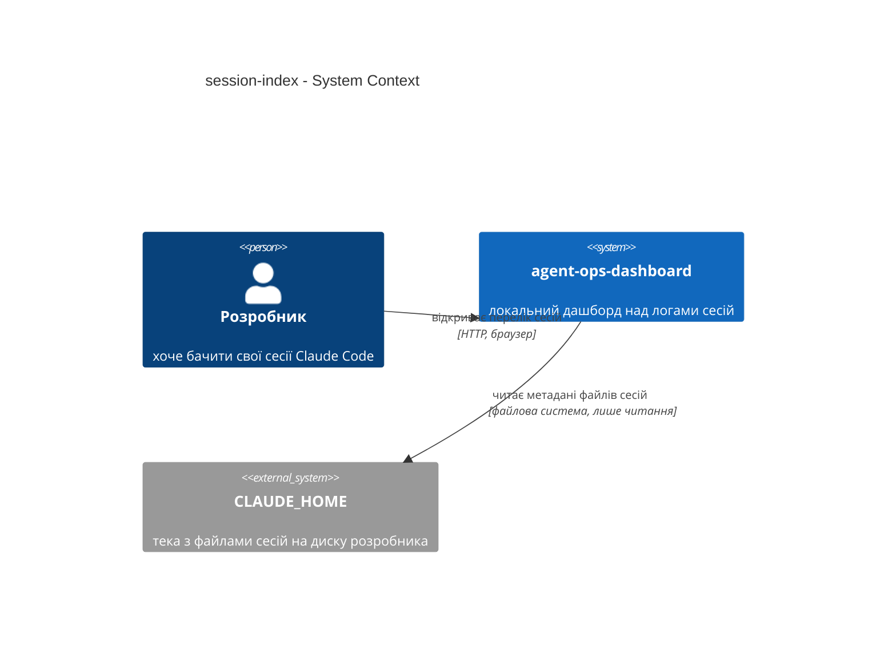
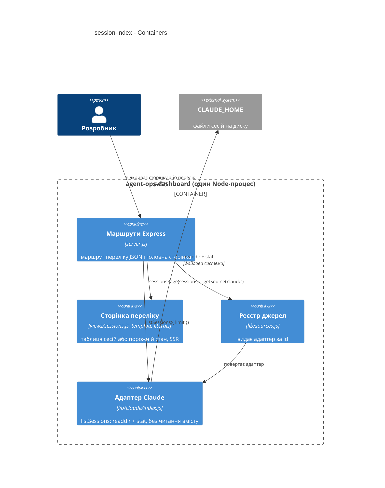
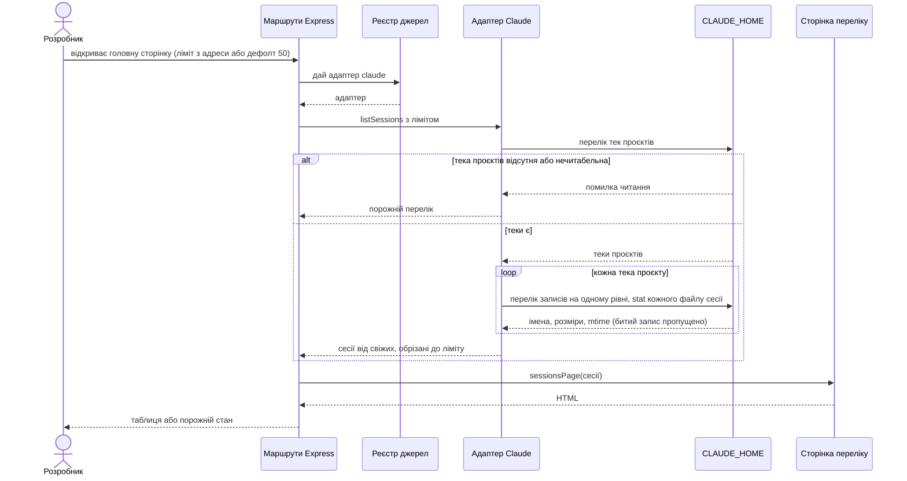

# Software Architecture Document - session-index

## 1. Introduction and goals

**Intent.** Перший зріз дашборда, який показує дані: перелік сесій Claude Code з проєктом, розміром і часом останньої зміни, від свіжих до старих, зібраний лише з метаданих файлів. Для розробника, який запускає дашборд на своїй машині. Разом з індексом зʼявляється маршрут, який віддає той самий перелік машинно, і сторінка, яка його малює.

**Top-3 quality goals (1-liners; full scenarios in §10):**

1. Точність: перелік дорівнює диску, без дублів і без вкладених транскриптів, у межах ліміту.
2. Швидкість без читання вмісту: відповідь на фікстурах ≤ 100 ms, нуль байтів вмісту прочитано.
3. Сумісність зі скелетом: перевірка здоровʼя, оболонка і два стартові тести працюють як були.

**Stakeholders.**

| Role | Interest | Sign-off owner? |
|---|---|---|
| розробник | бачить свої сесії і знаходить останню | No |
| Tech Lead | схвалює SAD і ADR | Yes |

## 2. Constraints

**Technical.**
- Node.js 20+, ES modules; локально 22, CI на 22 і 24 (`package.json`, `.nvmrc`, `.github/workflows/verify.yml`).
- Express ^5.1.0, єдина залежність; нових залежностей зріз не додає.
- Без БД: файлова система `CLAUDE_HOME`, лише читання.
- Сторінки рендеряться на сервері з template literals; build step відсутній. CSP оболонки: `default-src 'none'; style-src 'self'; script-src 'self'; connect-src 'self'; img-src 'self' data:` (`views/layout.js:17`); клієнтського JS у скелеті немає.

**Organisational.**
- Один зріз розміру S, на курсі це урок 3 і урок 4; реалізація одним агентом послідовно (`.claude/sdd.local.md`).
- Дедлайну немає: приймання за Verification Canvas уроку 5.

**Conventions.**
- `docs/architecture-map.md` §Conventions: реєстрація адаптерів через `registerSource`, помилки читання → порожній результат, тести на `node --test` без shell, оракули в `test/oracle.js`.
- `CLAUDE.md`: дані лише з `fixtures/`, `examples/` агентом не читати.
- Windows у CI: жодних `find`/`grep`/`wc`/`jq` у тестах; шляхи через `node:path`.

**Regulatory / external.**
- Security review N/A (spec §6.1): локальний інструмент, лише читання метаданих, сервер слухає `127.0.0.1`.

## 3. Context and scope

Дашборд працює на машині розробника, читає домашню теку Claude Code і показує перелік сесій у браузері. Зовнішніх систем немає: єдине «зовнішнє» це файлова система з логами, яку дашборд лише читає.

<!-- brownfield: карта `docs/architecture-map.md` свіжа за змістом (після `kit baseline` мінялися лише docs/), але її `reflects_commit: kit-baseline` не резолвиться в git; explorer не запускав, карту прочитав як є -->

**External systems (in / out):**

| Actor or system | Type | Interaction |
|---|---|---|
| розробник | Person | відкриває сторінку переліку в браузері, за потреби задає ліміт в адресі |
| CLAUDE_HOME (файлова система) | System (внутрішня, локальна) | дашборд читає імена, розміри і mtime файлів сесій; вміст не читає |

**C4 Context (L1):**



## 4. Solution strategy

**Top strategic choices (the seeds for ADRs):**

1. **Target surfaces: backend-service + web-frontend в одному процесі** - зріз додає маршрут, який віддає перелік машинно, і сторінку, яка його малює; обидва живуть в одному Express-процесі, як і скелет. UI-архітектура: server-rendered HTML з template literals, без клієнтського JS на цьому зрізі. Це конвенція репо, а не окреме рішення: build step відсутній, оболонка і стилі вже серверні (`docs/architecture-map.md` §Frontend), CSP дозволяє лише власні скрипти; SPA потребував би збірки, якої в репо немає. Інлайн, без ADR.
2. **Індекс лише з метаданих файлів** (ADR-0001) - перелік будується з `readdir` + `stat`, вміст файлу не відкривається. Тримає ціль «≤ 100 ms і 0 байтів», і лишає читання вмісту наступним крокам (заголовки, таймлайн).
3. **Сесія = файл рівно на один рівень під текою проєкту** (ADR-0002) - сканування не рекурсивне: `projects/<slug>/*.jsonl`, вкладені `subagents/` і `tool-results/` не відвідуються. Дає інваріант AC-04 і межу AC-03 одним правилом.
4. **Сторінка і маршрут беруть індекс через реєстр джерел** (ADR-0003) - `server.js` перестає імпортувати адаптер Claude напряму заради даних і бере `getSource('claude').listSessions()`. Закриває відкрите питання spec §8 і робить обіцянку «другий адаптер без змін сервера» перевірюваною.

Тактичні рішення далі мають тягнутися до одного з цих чотирьох. Похідний шлях проєкту з позначкою (spec AC-01d), дефолт 50 і tie-break за ідентифікатором сесії це вже вимоги spec, тут вони лише реалізуються.

## 5. Building block view

Стиль лишається як у скелеті: тонкий шар маршрутів у `server.js`, читання диска в адаптері `lib/claude/`, реєстр у `lib/sources.js`, чисті функції рендеру у `views/`. Жодного нового шару.

**Internal decomposition:**

```
lib/
├── sources.js          реєстр: registerSource / getSource / listSources (без змін контракту)
└── claude/
    └── index.js        + listSessions({ limit }): readdir(projectsDir) → readdir(<slug>) → stat → sort
views/
├── layout.js           оболонка (без змін)
└── sessions.js         + sessionsPage(sessions, { claudeHome }): таблиця або порожній стан
server.js               + маршрут переліку (JSON) і головна сторінка через getSource('claude')
test/
├── oracle.js           sessionFiles(projectsDir, { exactDepth: 2 }) як оракул для AC-04
└── session-index.test.js  приймальні тести зрізу
```

**C4 Container (L2):**



## 6. Runtime view

**Critical flow 1: розробник відкриває перелік сесій (happy + порожній стан)**



**Critical flow 2:** N/A - один актор, один запит; маршрут JSON іде тим самим шляхом без кроку рендеру.

## 7. Deployment view

<!-- N/A: reuses existing deployment unit, no infra change -->

Той самий локальний процес `node server.js` на `127.0.0.1:4180`; нічого не додається ні в запуск, ні в CI, крім нових тестів у тому самому `npm run verify`.

## 8. Crosscutting concepts

| Concept | Convention | Where defined |
|---|---|---|
| Logging | без змін: лише рядок про старт сервера; помилки читання диска не логуються, а перетворюються на порожній результат | `server.js:29`, ADR-0001 |
| Authentication | N/A: локальний інструмент без ролей, слухає лише localhost | spec §6.1 |
| Error handling | `try/catch` навколо `readdir`/`stat`; відсутня або нечитабельна тека → `[]`; битий запис → пропуск | `docs/architecture-map.md` §Conventions, spec AC-02/AC-02b |
| ID strategy | `sessionId` = імʼя файлу без `.jsonl`; `project` = імʼя теки; `projectPath` = відновлений шлях з міткою `derived: true` | `CONTEXT.md` §Glossary, spec AC-01d |
| Sorting | за `mtime` спадно, tie-break за `sessionId` зростаючи; стабільно на всіх ОС | spec AC-01 |
| Limits | `limit` з адреси; нечислове, 0 або відʼємне → 50; більше за 50 виконується як є | spec AC-01c |
| Internationalisation | N/A: інтерфейс і так змішаний (латинка в даних, українська в підписах), як у скелеті | - |
| Observability | N/A на цьому зрізі; час відповіді міряє приймальний тест | spec §6 |
| Tests | `node --test`, `startServer()` з `test/helpers.js`, оракули `test/oracle.js` без shell; нові тести в окремому файлі, скелетні тести не правляться | spec AC-05, `CLAUDE.md` |
| Paths | лише `node:path`, жодних ручних `/`, щоб Windows у CI лишався зеленим | `docs/architecture-map.md` §Constraints |
| Symlinks | `readdir` з `withFileTypes`; символічні посилання на теки і файли пропускаються (`isSymbolicLink()`), `stat` викликається лише для звичайних файлів | spec §8 (закрито тут), ADR-0002 |
| Output escaping | усі значення на сторінці проходять через `esc()`; імʼя теки з розміткою показується як текст | `views/layout.js:3-9`, spec §6.1 |

## 9. Architecture decisions

| # | Title | Status | Section |
|---|---|---|---|
| 0001 | Build the session index from file metadata only | Accepted | §4 |
| 0002 | Treat one-level jsonl files as the only sessions | Accepted | §4 |
| 0003 | Resolve the sessions page through the source registry | Accepted | §4 |

ADR files live under `docs/features/session-index/adr/NNNN-<title>.md`.

## 10. Quality requirements

**QG-1. Точність переліку**
- **When:** дашборд читає домашню теку з фікстур (шість сесій у трьох проєктах, поруч `subagents/` і `tool-results/`, плюс битий запис у тестовій копії)
- **Then:** 0 розбіжностей із диском: рядків рівно стільки, скільки файлів сесій на одному рівні під теками проєктів у межах ліміту; жодного двічі, жодного вкладеного
- **How verify:** приймальний тест звіряє кількість із `sessionFiles(projectsDir, { exactDepth: 2 })` з `test/oracle.js`

**QG-2. Швидкість без читання вмісту**
- **When:** перелік запитано на фікстурах, теплий прогін
- **Then:** ≤ 100 ms на відповідь (медіана з пʼяти запитів); 0 байтів вмісту файлів сесій прочитано
- **How verify:** таймер у приймальному тесті; ревʼю коду `listSessions` не знаходить читання вмісту; файл з битим вмістом у переліку з правильними розміром і часом

**QG-3. Сумісність зі скелетом**
- **When:** зріз підключено
- **Then:** перевірка здоровʼя відповідає як до зрізу, оболонка має ту саму політику безпеки вмісту, два стартові тести проходять із незміненими перевірками
- **How verify:** `test/skeleton.test.js` без правок у `git diff`; `npm run verify` зелений у CI на матриці з `docs/architecture-map.md` §Stack (ubuntu, macos, windows × Node 22/24)

## 11. Risks and technical debt

| Risk / debt | Severity | Mitigation | Owner |
|---|---|---|---|
| mtime фікстур після clone однаковий, тест на порядок стає тавтологією | Medium | `preverify`/`predemo` вирівнюють mtime; тест на порядок додатково перевіряє, що дати різні | Tech Lead |
| Агент напише тест через `find`/`wc` і зламає Windows у CI | Medium | правило в `CLAUDE.md` + оракул `test/oracle.js`; ревʼю дивиться на `child_process` | Tech Lead |
| Порядок при однакових mtime плаває між ОС | Low | tie-break за `sessionId` (spec AC-01) | розробник |
| Карта архітектури з `reflects_commit`, який не резолвиться | Low | після наступного коміту пакета записати реальний sha; поки читати карту як свіжу | лектор |
| Symlink у теці проєктів | Low | закрито в §8 Symlinks: посилання пропускаються, за ними не ходимо; spec §8 позначено як вирішене | Tech Lead |

**Accepted debt (acceptable in v1, plan to fix later):**
- Похідний шлях проєкту відновлюється заміною `-` на `/`, що неоднозначно для імен із дефісом; позначка «похідний» це визнає, точне відновлення можливе лише з `cwd` усередині файлу (крок S2+).
- Ліміт обрізає перелік без повідомлення «показано N з M»; загальну кількість можна додати, коли зʼявиться пагінація (non-goal S1).

## 12. Glossary

| Term | Meaning |
|---|---|
| сесія | один файл `<sessionId>.jsonl` рівно на один рівень під `projects/<slug>/`; не транскрипт субагента |
| індекс сесій | перелік сесій з метаданих файлів (імʼя, розмір, mtime) без читання вмісту |
| свіжість сесії | mtime файлу сесії; ключ сортування «від свіжих» |
| проєкт (project slug) | тека під `projects/`, імʼя = шлях cwd із `/` → `-`; відновлений шлях позначається як похідний |
| джерело (source) | адаптер агента, зареєстрований через `registerSource`; сторінка бере його з реєстру |
| порожній стан | відповідь «сесій не знайдено» для порожньої, відсутньої або нечитабельної теки |
| ліміт | кількість найсвіжіших сесій у відповіді; дефолт 50, задається в адресі |
