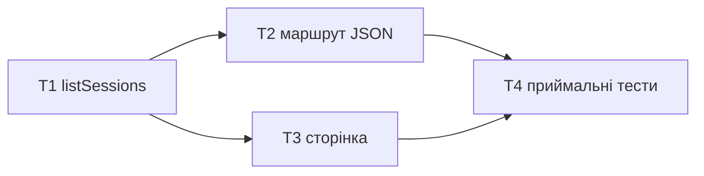

# Epic - session-index

> **Spec:** [spec.md](../spec.md) · **Design:** [sad.md](../sad.md) · **Data model:** немає (без БД) · **API:** стадію `api` пропущено, контракт у T2 · **ADRs:** [adr/](../adr/)

## Goal

Розробник відкриває дашборд і бачить перелік своїх сесій від свіжих з проєктом, розміром і часом, зібраний лише з метаданих файлів. Перелік дорівнює диску в межах ліміту, порожня тека дає порожній стан, скелет працює як був.

## Scope

- **In:** `lib/claude/index.js` (listSessions), `server.js` (маршрут переліку + головна сторінка через реєстр), `views/sessions.js` (таблиця), `test/session-index.test.js`.
- **Out:** заголовки сесій, таймлайн, токени, пагінація, друге джерело, продуктивність на тисячах сесій (spec §3).

## Task map

T2 і T3 за залежностями незалежні, але обидві правлять `server.js`, тому йдуть по черзі.

## Tasks

See [tracker.md](./tracker.md) for status. Machine contract: [tasks.json](../tasks.json).

| # | Task | Layer | Blocked by | DoD (short) |
|---|---|---|---|---|
| T1 | listSessions в адаптері Claude | infra | — | шість записів від свіжих, `[]` на битій теці, без читання вмісту |
| T2 | маршрут переліку JSON з лімітом | ports | T1 | `?limit=2` дає два найсвіжіші, невалідний ліміт дає 50 |
| T3 | сторінка переліку | ui | T1 | таблиця з похідним шляхом і позначкою; порожній стан без таблиці |
| T4 | приймальні тести зрізу | tests | T1, T2, T3 | інваріант з оракулом, різні mtime, ≤ 100 ms, скелетні тести без правок |

## Risks / Hard rules

- Тести без shell-команд; оракули з `test/oracle.js` (`CLAUDE.md`).
- mtime фікстур вирівнює `preverify`; тест на порядок перевіряє, що дати різні (`sad.md` §11).
- `test/skeleton.test.js` не правиться (spec AC-05).
- Жодного читання вмісту файлів сесій (ADR-0001).
