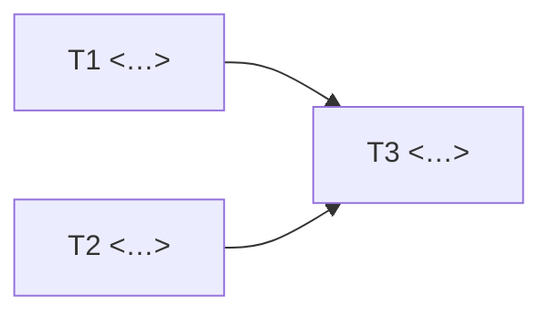

# Agentic Workflow Map - <slug>

Коли вимоги й підхід уже описані, можна вирішувати, як виконувати роботу. Спочатку розклади її на задачі та перевір залежності. Потім запиши, хто виконує кожен крок, хто його перевіряє і коли потрібно зупинитися. Якщо для твоєї задачі достатньо одного виконавця та свіжого рецензента, залиш саме такий маршрут.

В уроці 4 збережи власну копію як `docs/practice/04-workflow.md`. Відкрий свої `tasks.json`, файли задач і spec із розділом `Test plan` з уроку 3. За ними заповни §1–§3; кількість та ідентифікатори задач мають відповідати твоєму плану. SDD не заповнює цей шаблон автоматично.

Перед реалізацією виконай `npm run verify` і `git status --short`, переглянь та закоміть погоджені документи підготовки. Потім `git rev-parse HEAD` покаже повний ідентифікатор початкового коміту. Скопіюй його в `base_commit` вище. Не переписуй історію до цієї точки під час вправи. Назва робочої гілки може бути будь-якою.

Після виконання заміни `BASE_COMMIT` у цих командах на збережений ідентифікатор, залишивши `..HEAD`:

```sh
git log --oneline BASE_COMMIT..HEAD
git diff BASE_COMMIT..HEAD
git status --short
```

Перші дві команди показують закомічену роботу після початкової точки; остання допоможе помітити зміни, які ще не потрапили до комітів. За потреби відкрий незакомічений diff і нові файли окремо. Поруч із планом у §2 запиши фактичну послідовність задач та результат свого gate.

<!-- instruction: два документи в одному, бо вони читаються разом.

§1-§3: план робіт. Задачі на день або менше, кожна з власним DoD і з тим, які AC вона
закриває. Граф залежностей чесний: паралель лише там, де задачі не ділять файли.

§4-§7: карта виконання. Хто робить кожен крок (скрипт, скіл, агент, людина), що отримує на
вхід, що віддає, хто перевіряє і що відбувається при відмові. Кількість агентів результатом
не є. Один виконавець і свіжий рецензент це повноцінний маршрут.

Пишеться після spec і design, до першого рядка коду. -->

## 1. Задачі

<!-- instruction: одна задача = один шар (parse / list / wiring / view / tests), ≤1 дня,
один PR, який можна прочитати. Кожна задача самодостатня: у її файлі
(`docs/features/<slug>/tasks/T<n>-<slug>.md`) інлайновані саме ті AC, той шматок design
і ті поля даних, які їй потрібні, з підписом джерела (`spec.md §5, AC-02, verbatim`).
«Дивись spec» замість інлайну не приймається: виконавець не має реконструювати контекст.

`files_hint` обовʼязковий: саме перетин файлів вирішує, що йде паралельно. Дві задачі з
одним файлом у `files_hint` серіалізуються навіть без залежності. -->

| # | Задача | Шар | Залежить від | AC | files_hint | DoD (коротко) |
|---|---|---|---|---|---|---|
| T1 | <імперативна назва> | <infra/domain/app/wiring/ui/tests> | - | AC-0N | `<path>` | <тест, який має позеленіти> |
| T2 | <…> | <…> | T1 | AC-0N | `<path>` | <…> |

## 2. Граф і хвилі

<!-- instruction: mermaid-граф із §1, потім хвилі. Хвиля = задачі, які можуть іти одночасно
в окремих worktree без спільних файлів. Послідовний план з однієї задачі на хвилю допустимий
і часто правильний: обґрунтуй залежностями, не додавай паралель для вигляду.

Пастка з уроку 4: у лектора задачі маршруту і сторінки за залежностями незалежні, обидві
чекають лише на індекс, але йдуть по черзі, бо обидві правлять `server.js`. Граф залежностей
і граф файлів це різні графи. -->



| Хвиля | Задачі | Чому безпечно разом | Що відкриває |
|---|---|---|---|
| 1 | <T1 ∥ T2> | <різні файли: …> | T3 |
| 2 | T3 | <…> | - |

## 3. Definition of Done кожної задачі

<!-- instruction: DoD це контракт задачі, AC це контракт фічі. Задача може бути done, коли
фіча ще не прийнята: у лектора індекс у `lib/` був done, а сторінка ще показувала порожній стан.
Кожен пункт перевірюваний. Пункти, для яких у репо немає команди (лінтер, якого нема),
не вигадуй: познач «немає команди», це теж знахідка. -->

- [ ] тест задачі був RED з правильної причини (відсутня поведінка, не помилка запуску) і став GREEN
- [ ] `<команда повного gate>` зелена після зміни
- [ ] інлайновані hard rules з design не порушені
- [ ] коміт з трейлером, який називає закриті AC

## 4. Карта виконання

<!-- instruction: один рядок на крок, включно з кроками людини. Виконавець це один із:
скрипт (детермінована операція), скіл (повторювана інструкція), агент (обирає наступну дію),
людина. Колонка «Чому саме він» обовʼязкова: найпростіший достатній механізм.
«На помилку» має конкретну дію: повернути крок, уточнити spec, зупинити залежні, віддати
рішення людині. -->

| Крок | Виконавець | Чому саме він | Вхід | Вихід | Хто і як перевіряє | На помилку |
|---|---|---|---|---|---|---|
| Уточнення spec | людина + агент | продуктові рішення не делегуються | spec, карта | RESOLVED/DEFERRED у §9 spec | людина читає діф spec | питання власнику |
| RED-тест задачі | агент (test-author) | пише тест без коду, не бачить реалізації | задача з інлайном AC | тест + рядок падіння | клас падіння: assertion, не setup | переписати тест |
| Реалізація | агент (implementer) | мінімальний код під конкретний тест | задача + рядок падіння | зелений тест, коміт | gate | ще спроба до ліміту, потім людина |
| Gate | скрипт | детермінований, не міркує | стан репо | exit code + лог | - | зупинити передачу далі |
| Review | свіжа сесія / колега | без історії виконавця | spec + diff + вивід gate | findings з `file:line` або чистий вердикт з межами | людина звіряє з AC | fix або обґрунтоване рішення |
| Приймання | людина | рішення не делегується | всі докази | так / ні / з обмеженням | - | повернути на крок |

## 5. Автономність і права

<!-- instruction: щабель для цього зрізу і чому вистачає саме його. Права кожної ролі і
чим вони реально обмежені. Інструкція «код не редагуй» це правило ролі. Агент
із Bash усе одно може писати. Технічна заборона потребує permissions або read-only копії. Не називай
інструкцію ізоляцією.

Fresh session для рецензента: нова сесія без історії. Fork успадковує історію виконавця і
рецензентом не є. Worktree ізолює checkout і індекс git, не порти, не базу, не файли поза ним. -->

- **Щабель:** <один агент послідовно / субагенти на ролі / команда агентів / автономний цикл> - чому вистачає: <…>
- **Виконавець може:** <…>; **не може:** <…>; **чим гарантовано:** <permissions / copy / лише інструкція>
- **Рецензент:** <fresh session / людина>; **бачить:** <spec, diff, вивід>; **не бачить:** <історію виконавця>
- **Ізоляція паралелі:** <worktree на задачу / нема паралелі>

## 6. Обмежений цикл

<!-- instruction: якщо в маршруті є повтор «спроба → перевірка → ще спроба», ліміт живе
всередині механізму, не в коментарі. Три речі: умова зупинки, максимум ітерацій, бюджет.
Приклад із SDD: `max_red_retries: 3`, потім ескалація людині. Цикл без ліміту в карту не
приймається. -->

- **Умова зупинки:** <gate зелений / рецензент без findings>
- **Максимум ітерацій:** <N>, потім: <ескалація кому>
- **Бюджет:** <час / токени / гроші> - як міряється: <…>

## 7. Self-check карти

<!-- instruction: свіжа сесія, лише цей файл і spec. Після відповіді карту виправити.
Список зауважень без правок вправу не завершує. -->

```text
Прочитай карту виконання і spec. Знайди: перетини відповідальності між кроками;
передачі, де вихід попереднього кроку не містить входу наступного; приховані спільні
ресурси в задачах однієї хвилі; цикли без ліміту; ролі, чиї права тримаються лише на інструкції
без механізму. Для кожної знахідки: номер кроку і приклад відмови. Не пропонуй
паралель там, де послідовність обґрунтована.
```

- **Знайдено:** <…>
- **Виправлено:** <…>

## Готово, коли

- [ ] кожна задача ≤1 дня, з `files_hint`, DoD і AC
- [ ] хвилі виведені з перетину файлів, не лише з залежностей
- [ ] у кожного кроку карти є артефакт на виході і дія на помилку
- [ ] права ролей описані механізмом або прямо названі інструкцією
- [ ] цикл має ліміт усередині
- [ ] карта виправлена після self-check

## Де це живе в інструментах

<!-- instruction: §1-§3 цієї карти заповни за результатами `/sdd:tasks <slug>`
(`docs/features/<slug>/tasks/`, `tasks.json`, `tracker.md`) і `/sdd:plan-tests <slug>`.
Для розміру S план перевірок лежить у spec.md. Саму карту ці команди не генерують.
§4-§6 у SDD задаються в `.claude/sdd.local.md` (`team_mode`, `workflow_mode`,
`max_parallel_agents`, `isolation`, `max_red_retries`, `stop_on_red`) і виконуються через
`/sdd:implement <slug>`. Цей файл лишається людською картою поверх них. Приклад лектора:
`examples/session-index/tasks/`. Відповідники в інших фреймворках:
`ALTERNATIVES.md`. -->
